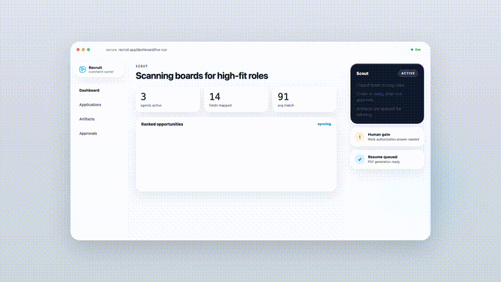
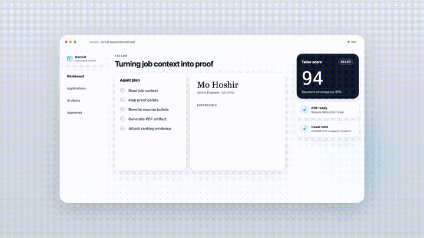
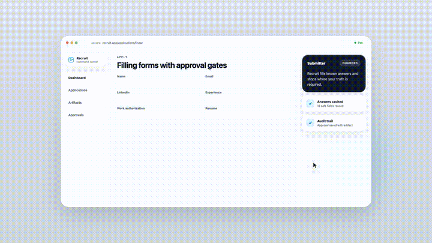
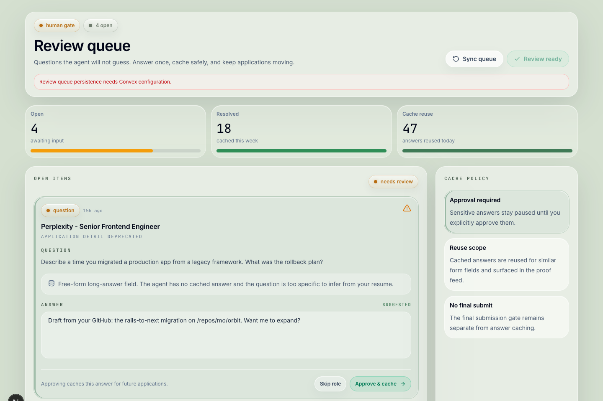
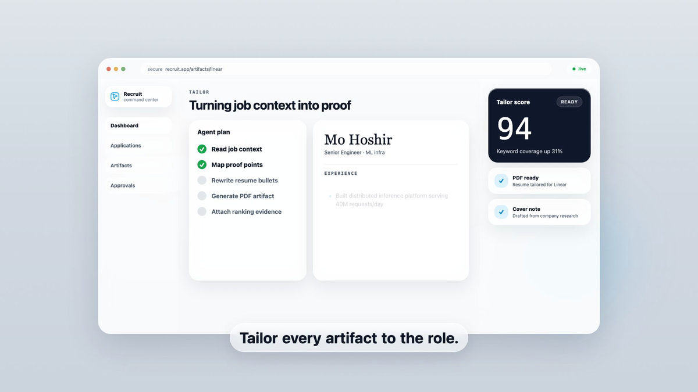
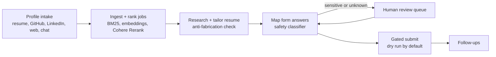

# Recruit

### AI agents that apply to jobs for you, and stop to ask when they shouldn't guess.

[](https://github.com/recruitttt/recruit-main/actions/workflows/ci.yml)
[](LICENSE)
[](https://nextjs.org)
[](https://www.typescriptlang.org)
[](https://www.convex.dev)

🏆 **1st place, YC track** and **3rd place, SideShift track** at **HackTech 2026**

<p align="center"></p>

**[Devpost](https://devpost.com/software/recruit-h3lc2r)** · **[Architecture](docs/ARCHITECTURE.md)** · **[Run it locally](#run-locally)**

<!-- TODO(owen): add the live app link here once the production URL is final. -->

## What it does

Recruit takes one candidate profile and runs the whole application loop, with a
human in charge of anything that needs the truth.

- **Builds your profile from what already exists.** Resume, GitHub, LinkedIn,
  personal sites and a short chat merge into one profile, and every field
  records where it came from.
- **Finds and ranks roles.** It ingests jobs from Ashby, Greenhouse, Lever and
  Workable, then ranks them with BM25, embeddings and Cohere Rerank. The LLM
  writes the rationale but never decides the order.
- **Tailors a resume for each role.** It researches the company, rewrites the
  resume to fit, and rejects any output that invents an employer, degree or
  project.
- **Fills the application.** It answers what the profile can safely answer.
  Questions about work authorization, salary, demographics or legal terms go to
  a review queue instead of being guessed.
- **Runs agents in parallel and shows the work.** A live dashboard and a 3D
  agent room show every run, and every submit is gated and dry-run by default.

## Demo

| Discover | Tailor | Apply |
| :---: | :---: | :---: |
|  |  |  |
| Ingest jobs and rank the best fits. | Research the role and produce a tailored PDF. | Map ATS questions and stop before unsafe guesses. |

| Human review queue | Tailored resume |
| :---: | :---: |
|  |  |
| Questions the agent won't guess wait here, and approved answers are reused. | Each resume is scored on fit and keyword coverage. |

<!-- TODO(owen): record a 20-30s screen capture of a full run (onboarding to review queue) and add it above the table. -->

## Architecture

A Next.js 16 app serves the UI and API routes. Convex stores all state and runs
the long background work (intake, ingestion, ranking, application jobs), and
the UI subscribes to it live. Live browser submits go through a separate apply
engine behind a small service boundary.



The full write-up, with the system diagram, data model and safety rules, is in
**[docs/ARCHITECTURE.md](docs/ARCHITECTURE.md)**.

## Tech stack

| Layer | Tools |
| --- | --- |
| App | Next.js 16 (App Router), React 19, TypeScript, Tailwind CSS v4 |
| Backend | Convex (database, actions, scheduler), Better Auth |
| AI | OpenAI, Anthropic and Gemini via the AI SDK or Vercel AI Gateway, Cohere Rerank, MiniSearch |
| Automation | Browserbase, Playwright Core, Puppeteer Core, ATS adapters for Ashby and Lever |
| UI extras | Three.js, React Three Fiber, Motion |
| Tooling | Vitest, tsx, Playwright, ESLint, GitHub Actions, Vercel |

## Run locally

**Prerequisites:** Node.js 20+ and npm.

```bash
git clone https://github.com/recruitttt/recruit-main.git
cd recruit-main
npm install
cp .env.example .env.local   # every key is optional for a local UI run
npm run dev                  # http://localhost:3000
```

With no keys set, the dashboard uses the sample jobs checked in under
`data/om-demo`. To use real data, add keys to `.env.local` by area:

| To enable | Set |
| --- | --- |
| Convex data and live updates | `NEXT_PUBLIC_CONVEX_URL`, `NEXT_PUBLIC_CONVEX_SITE_URL` (then run `npx convex dev`) |
| Sign-in and GitHub intake | `BETTER_AUTH_SECRET`, `GITHUB_CLIENT_ID`, `GITHUB_CLIENT_SECRET` |
| Ranking, research and tailoring | `OPENAI_API_KEY` or `AI_GATEWAY_API_KEY`, plus `COHERE_API_KEY` for reranking |
| LinkedIn intake | `BROWSERBASE_API_KEY`, `BROWSERBASE_PROJECT_ID`, `COOKIE_ENCRYPTION_KEY` |
| Live applications | `APPLY_ENGINE_API_URL` (submits stay dry runs unless you set the submit gate) |

[`.env.example`](.env.example) lists every variable with a short note.

## Tests

```bash
npm test             # vitest unit suites, core logic and API contract tests
npm run typecheck
npm run lint
npm run ci:quality   # everything CI runs, including the production build
npm run test:e2e     # Playwright browser journeys (local only)
```

The suites cover ranking and the ranking eval, the form-safety classifier,
tailoring quality and anti-fabrication, ATS normalizers, the LinkedIn parsers,
and the apply-service API. CI runs on every push and pull request.

## Project structure

```
app/            Next.js routes: UI pages and app/api route handlers
components/     UI: dashboard, onboarding, profile graph, 3D room, design system
lib/            Core logic: intake, ingestion, ranking, tailor, form-engine, apply-service
convex/         Schema, queries, mutations and background actions
tests/          Unit, API and Playwright suites
evals/          Ranking and ATS resume benchmarks
docs/           Architecture, design specs and runbooks
```

## Team

Built at HackTech 2026 by:

- **Om Sanan** ([@anti-integral](https://github.com/anti-integral))
- **Owen Fisher** ([@obro79](https://github.com/obro79))
- **Mo Shirmohammad** ([@mohosy](https://github.com/mohosy))
- **Jimin Bang**

## License

[MIT](LICENSE)
