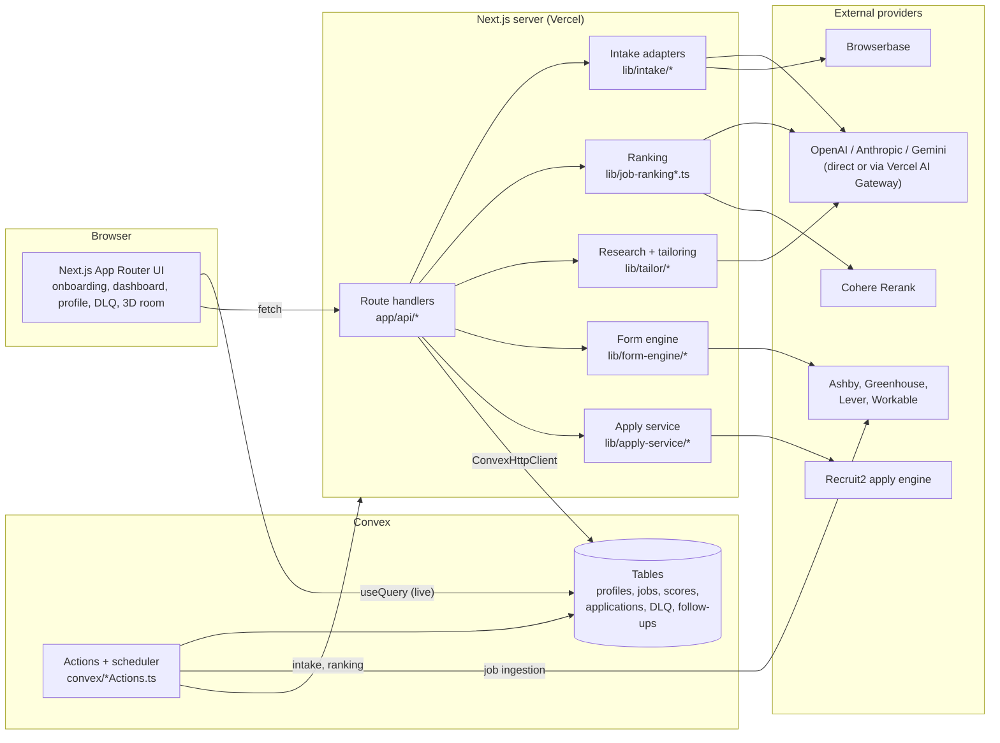
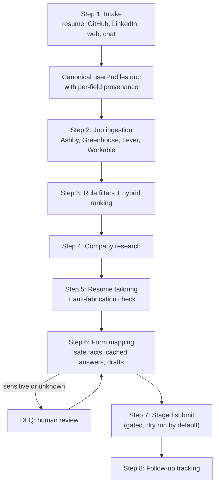

# Architecture

Recruit turns one candidate profile into a supervised job-application
pipeline. A Next.js 16 app handles the UI and the API routes, Convex holds all
state and runs long background actions, and a separate apply engine
(Recruit2) drives the browser for live application submits.

This document covers how the pieces fit together. The design history lives in
[`docs/superpowers/specs/`](superpowers/specs/).

## System overview



The client subscribes to Convex with `useQuery`, so pipeline progress,
intake runs and application states update live without polling. Server code
calls Convex through `ConvexHttpClient` from route handlers, or runs inside
Convex actions when the work is long-running or scheduled.

## The pipeline



### 1. Profile intake (`lib/intake/`)

Every data source implements one contract, `IntakeAdapter<TInput>` in
`lib/intake/shared/types.ts`. An adapter is an async generator that yields
progress events. An event can carry a `patch` (a partial profile) and a
`provenance` map from field path to source.

`runIntake` (`lib/intake/shared/runIntake.ts`) is the only code that writes
those events to Convex. It appends each event to an `intakeRuns` row, which
the UI streams, and merges patches into the `userProfiles` doc. It also strips
cookies, tokens and live-view URLs before anything is persisted.

| Adapter | Source | Notes |
| --- | --- | --- |
| `github` | GitHub GraphQL + REST | Fires automatically after GitHub OAuth. Summarizes repos and source files with an LLM. |
| `linkedin` | Browserbase session | Runs as a Next.js route, not a Convex action, because `playwright-core` can't be bundled by Convex. The `li_at` cookie is stored AES-256-GCM encrypted. |
| `resume` | PDF upload | `unpdf` text extraction, then LLM structuring. |
| `web` | Personal sites, Devpost | Scrape, then extract. |
| `chat` | Onboarding chat | Turns answers into profile patches. |

### 2. Job ingestion (`lib/ingestion/`, `convex/atsIngestion.ts`)

Sources are listed in `config/ingestion-sources.json`. Each ATS has a
normalizer (`normalizeAshbyJob`, `normalizeGreenhouseJob`, ...) that maps its
public job-board API onto one `IngestedJob` shape. Runs and jobs are stored in
`ingestionRuns` and `ingestedJobs`.

### 3. Ranking (`lib/job-ranking.ts`, `lib/job-ranking-v2.ts`)

Ranking runs in stages so that an LLM is never the judge of relevance:

1. **Rule filters** reject jobs below the salary floor or outside the
   candidate's locations, and apply soft penalties for seniority or role
   family mismatches. Each decision and its reasons is stored in
   `jobFilterDecisions`.
2. **Hybrid retrieval** combines BM25 (MiniSearch) with dense embeddings and
   merges the two lists with Reciprocal Rank Fusion.
3. **Cohere Rerank** orders the top candidates.
4. **An LLM writes rationale only**: strengths and risks for the final
   shortlist. It cannot change the order.

v1 let a small LLM score relevance directly and it overrated loosely related
roles. v2 removed that failure mode. If embeddings or the reranker are not
available, v2 falls back to BM25-only ranking (`mode: "v2_bm25"`, covered by
`tests/job-ranking-v2-fallback.test.ts`).

`evals/ranking/` holds a labelled dataset and metrics, and
`tests/ranking-eval.test.ts` runs that eval in CI.

### 4 and 5. Research and tailoring (`lib/tailor/`)

`research.ts` builds a `JobResearch` record (requirements, tech stack,
company context) from the posting and, when OpenAI is configured, from the
web. `tailor.ts` then asks the model for a `TailoredResume` in JSON mode.

The output is validated before it is accepted. `validateResumeQuality`
rejects any employer, degree or project that isn't in the input profile, and
the call is retried once at temperature 0 if validation fails. `score.ts`
reports a tailoring score:

```
score = round(0.6 * model confidence + 0.4 * keyword coverage of the posting)
```

The resume is rendered to HTML (`lib/resume-html.ts`) and then to PDF.
`evals/ats-benchmark/` compares tailored resumes against an external
resume-matcher.

### 6. Form engine and the DLQ (`lib/form-engine/`)

Each ATS adapter (`ashby-adapter.ts`, `lever-adapter.ts`) parses the form
into a provider-neutral `QuestionIR`. `safety.ts` classifies every question:

| Class | Examples | What happens |
| --- | --- | --- |
| Safe profile fact | name, email, links | Filled from the profile. |
| Approved cached answer | a reused "why this company" | Reused when the prompt and scope match. |
| Narrative | free-text custom questions | An LLM drafts it. |
| Hard truth | work authorization, sponsorship, salary, start date | Sent to the DLQ. |
| Demographic or legal | EEO fields, attestations, consent | Sent to the DLQ. |
| Unknown required | anything else | Sent to the DLQ. |

Answers resolved in the DLQ (`convex/dlq.ts`) become approved cached answers
(`ashbyApprovedAnswers`), so the same question is not asked twice.
`idempotency.ts` derives a key from the canonical job URL and the provider's
job ID, which stops the same application from being submitted twice.

### 7. Apply service (`lib/apply-service/`)

The apply service is the boundary between this repo and the Recruit2 browser
engine. Recruit owns discovery, the shortlist, profile memory, tailoring and
the grouped review questions. Recruit2 owns browser perception, Browserbase
sessions, computer-use actions and file uploads.

`POST /api/applications/batch/start` normalizes a batch and forwards it to
`APPLY_ENGINE_API_URL`. If no engine URL is configured, the batch falls
through to the Convex engine (`convex-engine.ts`), which schedules one
`applicationJobs` row per job.

| Route | Purpose |
| --- | --- |
| `POST /api/applications/batch/start` | Start a multi-job batch. |
| `GET /api/applications/runs/:runId` | Run state, job states, review items and question groups. |
| `GET /api/applications/runs/:runId/events` | Event timeline. |
| `GET /api/applications/runs/:runId/questions` | Grouped deferred questions. |
| `POST /api/applications/runs/:runId/questions/resolve-batch` | Apply one answer across every matching field and job. |
| `POST /api/applications/runs/:runId/jobs/:jobId/approve` | Approve a job. In development this marks it `submitted_dev` without clicking submit. |
| `POST /api/applications/runs/:runId/jobs/:jobId/cancel` | Cancel one job. |

Final submit is gated. `DEV_SKIP_REAL_SUBMIT` defaults to true, and a real
Ashby submit also needs `RECRUIT_ASHBY_SUBMIT_GATE=1` and a URL listed in
`RECRUIT_ASHBY_ALLOWED_SUBMIT_URLS`. Without both, the run stays a dry run.

## Provider status

| Provider | Role | Status |
| --- | --- | --- |
| Ashby | Ingestion, form fill, evidence capture | Live |
| GitHub | OAuth and profile intake | Live |
| LinkedIn | Browserbase profile intake | Preview |
| Lever | Ingestion and form-fill adapter | Preview |
| Greenhouse, Workable | Ingestion | Preview |
| Stripe | Checkout | Test mode or mocked |

## Data model

All tables are defined in `convex/schema.ts`. They fall into these groups:

| Area | Tables |
| --- | --- |
| Profile | `userProfiles`, `githubSnapshots`, `repoSourceFiles`, `repoSummaries`, `linkedinSnapshots`, `linkedinCookies`, `experienceSummaries`, `aiReports`, `intakeRuns` |
| Jobs | `ashbySources`, `atsSources`, `ingestionRuns`, `ingestedJobs`, `jobFilterDecisions`, `jobScores`, `jobRecommendations` |
| Applications | `tailoredApplications`, `applicationJobs`, `applicationJobCheckpoints`, `applicationJobEvidence`, `applications`, `jobPipelineArtifacts`, `pipelineLogs` |
| Form answers | `ashbyFormFillRuns`, `ashbyPromptAliases`, `ashbyApprovedAnswers`, `ashbyPendingReviews`, `ashbyTargetHistory` |
| Outreach | `recruiters`, `recruiterConversations`, `followUpTasks`, `outreachDrafts` |

Profile and intake functions guard access with `requireOwner(ctx, userId)`.

## LLM routing

`lib/llm-routing.ts` sends OpenAI-compatible calls through the Vercel AI
Gateway when `AI_GATEWAY_API_KEY` is set, and straight to the provider
otherwise. Calls made through the AI SDK pick up the gateway on their own.
The tailoring and research steps can be switched to Gemini or Gemma with
`TAILOR_PROVIDER` and `RESEARCH_PROVIDER`.

## Testing

| Layer | Where | Runner |
| --- | --- | --- |
| Pure logic (ranking, safety, tailoring, parsers) | `tests/*.test.ts`, `lib/**/__tests__` | `tsx` scripts with `node:assert`, plus `vitest` |
| Route contracts | `tests/api-contracts.test.ts`, `tests/apply-service-api.test.ts` | `tsx` |
| Ranking quality | `evals/ranking/` via `tests/ranking-eval.test.ts` | `tsx` |
| Browser journeys | `tests/e2e/*.spec.ts` | Playwright (run locally) |

CI (`.github/workflows/ci.yml`) runs lint, typecheck, every unit and API
suite, and a production build on each push and pull request.
